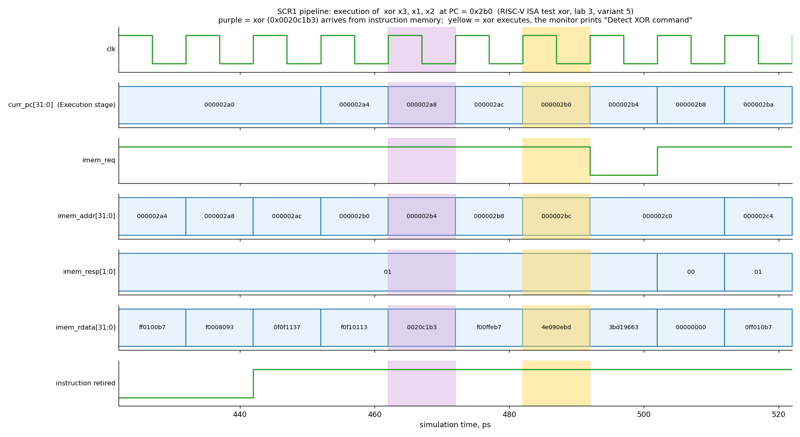

# Lab 3 — Analysis of the SCR1 pipeline: the `xor` instruction

**Variant:** 5

## 1. Task (variant 5)

| Item | Value |
|------|-------|
| Instruction under study | `xor` |
| Debug information | print the state registers |

Goals: run the test that uses the instruction, study its execution in the
pipeline on a waveform (`clk`, `curr_pc`, and the instruction fetch signals
`imem_req`, `imem_addr`, `imem_resp`, `imem_rdata`), add a non-synthesizable
block to the verification environment that detects the instruction in the
pipeline and prints the debug information, and save the waveform screenshot
and the output of the block in the `report` folder.

## 2. What was changed (branch `lab3_scr1_pipe_analys`, created from `master`)

| File | Change |
|------|--------|
| `sim/tests/riscv_isa/rv32_tests.inc` | only the test `isa/rv32ui/xor.S` is built |
| `src/tb/scr1_tb_log_cmd.sv` | **new**: the non-synthesizable monitor module |
| `src/tb/scr1_top_tb_ahb.sv` | the monitor is instantiated in the AHB testbench (`i_tb_log_cmd`) |
| `src/ahb_tb.files` | the new file is added to the file list of the AHB testbench |

## 3. The monitor `scr1_tb_log_cmd`

It uses `$display` and hierarchical references into the core, so it is for
simulation only and is not part of the synthesized design.

**Detection.** The instruction is detected while it is being *executed*, not
when it is fetched: in the cycle in which `instret_nexc` (instruction retired
without an exception) is 1 and the command in the EXU register `exu_queue` is
the ALU command `SCR1_IALU_CMD_XOR` with `SCR1_IALU_OP_REG_REG` (so `xori`,
which uses an immediate, is not matched). `exu_queue` is used because in the
default configuration (`CFG=MAX`) there is a register between the IDU and the
EXU: `idu2exu_cmd` already shows the *next* instruction, while `exu_queue`
holds the instruction that is executed now, together with the register values
and the result.

**Sampling.** The monitor samples on the falling edge of the clock
(`always @(negedge clk)`): on the rising edge it races with the registers that
are updated by that edge, and the printed operands belonged to a different
instruction.

**Self-check.** The monitor also checks that the value written back equals
`rs1 ^ rs2` (`$error` otherwise). The check never fired in the run.

**What is printed.** The line `Detect XOR command` shows the cycle number, the
PC (`curr_pc`), whether the instruction is compressed, the registers
(`rd = rs1 ^ rs2`) and the operand values with the result. The line
`state regs` shows the **state registers of the core** (the CSRs):

| Register | Printed fields |
|----------|----------------|
| `mstatus` | `mie`, `mpie` |
| `mtvec` | full value (base and mode) |
| `mie` | `meie`, `mtie`, `msie` |
| `mip` | `meip`, `mtip`, `msip` |
| `mepc` | full address |
| `mcause` | interrupt flag and exception code |
| `mtval` | value |

The task text does not say which registers are meant by "state registers";
the machine-mode state (status and trap CSRs) was chosen.

## 4. How to run

```bash
git submodule update --init --recursive
export PATH=<riscv-toolchain>/bin:$PATH
make clean
make run_verilator_wf TARGETS="riscv_isa" TRACE=1
```

The waveform is `build/verilator_wf_AHB_MAX_imc_IPIC_1_TCM_1_VIRQ_1_TRACE_1/simx.vcd`;
it is opened with `gtkwave simx.vcd -S xor_signals.tcl` (the script adds the
signals listed below).

## 5. Result

The test passes (`Test passed`, `Summary: 1/1`). The monitor detected the
`xor` instruction 41 times (the test executes it in many test cases); the
whole output is in `xor_monitor_output.txt`. The first detection:

```
[cycle 48] Detect XOR command: pc=0x000002b0 rvc=0  x3 = x1 ^ x2  (0xff00ff00 ^ 0x0f0f0f0f = 0xf00ff00f)
    state regs: mstatus{mie=0 mpie=1} mtvec=0x000001c0 mie{meie=0 mtie=0 msie=0} mip{meip=0 mtip=1 msip=0} mepc=0x000002a0 mcause{irq=0 code=0} mtval=0x00000000
```

`0xff00ff00 ^ 0x0f0f0f0f = 0xf00ff00f`: the operands and the result are correct.
The state registers show: interrupts are disabled (`mstatus.mie = 0`), `mtvec`
holds the default trap vector `0x1C0`, no interrupt is enabled in `mie`, only
the machine timer interrupt is pending in `mip` (`mtip = 1`; it is not
taken because `mie` is 0). `mepc = 0x2A0` is the address of `_run_test`: the
startup code (`_start`) writes it with `csrw mepc, t0` and starts the test with
`mret`; `mcause` and `mtval` still have their reset values (no trap is taken
while `xor` is executed).

### Waveform



Signals: `clk`; `curr_pc` (PC of the instruction in the Execution stage, the
signal `curr_pc` of `i_pipe_top`); `imem_req` (`pipe2imem_req_o`) and
`imem_addr` (`pipe2imem_addr_o`) are the request of the core to the
instruction memory and its address; `imem_resp` (`imem2pipe_resp_i`, `01` =
data is valid) and `imem_rdata` (`imem2pipe_rdata_i`) are the response and
the data; `instret_nexc` marks the retired instruction.

How the first `xor` (`xor x3, x1, x2`, encoding `0x0020C1B3`, address `0x2B0`)
goes through the pipeline:

1. The core requests the address `0x2B0` (`imem_req = 1`, `imem_addr = 0x2B0`).
2. Its code `0x0020C1B3` arrives on `imem_rdata` with `imem_resp = 01` one
   cycle later (purple cycle, `t = 462 ps`).
3. Two cycles later (decode, then execution) the instruction is in the
   Execution stage: `curr_pc = 0x2B0` (yellow cycle, `t = 482 ps`). In this
   cycle the monitor prints `Detect XOR command`.

Fetch and execution are therefore separated by two clock cycles, and the
fetch of the next instructions continues in parallel (the memory interface
is already busy with addresses `0x2B4`, `0x2B8`, `0x2BC`). When `imem_resp`
becomes `00` (not ready) at `t = 502 ps`, `imem_req` has been low during the
previous cycle: the fetch pauses.

## 6. Saved files (`report/`)

| File | Content |
|------|---------|
| `wave_xor.png` | waveform with the signals of the task around the first `xor` |
| `xor_monitor_output.txt` | output of the monitor (41 detections with state registers) |
| `xor_signals.tcl` | GTKWave script that loads the signals and sets the marker |
